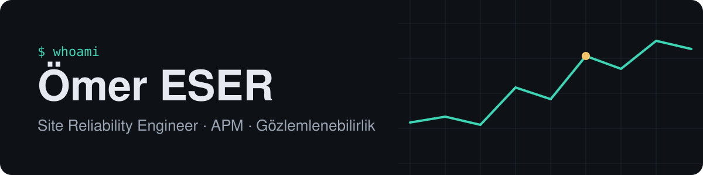

  

  

  
  
  
  

---

### Merhaba, ben Ömer

Bankacılık ve havacılıkta kritik sistemlerin **7/24 ayakta kalmasını** sağlayan bir Site Reliability Engineer'ım. 4 yılı aşkın süredir **APM ve gözlemlenebilirlik** üzerinde çalışıyorum; şu an Turkish Technology'de Turkish Airlines'ın mürettebat yönetim sistemi (CMS) için izleme, olay müdahalesi ve operasyonel otomasyon yapıyorum. Öncesinde .NET backend geliştirdim, bu yüzden bir sorunu grafikte değil kodda da arayabiliyorum.

<table>
  <tr>
    <td width="33%" valign="top">
      <h4>APM &amp; gözlemlenebilirlik</h4>
      Dynatrace, Grafana, ELK, Graylog ve Splunk ile izleme kurulumu ve yönetimi; Filebeat ingest pipeline'ları.
    </td>
    <td width="33%" valign="top">
      <h4>Otomasyon</h4>
      Node-RED akışları, problem kaydı takip botu, uç nokta sağlık kontrolleri; Python ve Ansible AWX.
    </td>
    <td width="33%" valign="top">
      <h4>Yazılım geçmişi</h4>
      C#, .NET Core, Web API, Blazor, EF Core; eski servisleri temiz mimariye taşıma deneyimi.
    </td>
  </tr>
</table>

### Deneyim

| Dönem | Rol | Şirket |
| :-- | :-- | :-- |
| **2023 – bugün** | Site Reliability Engineer | **Turkish Technology** · İstanbul |
| 2022 – 2023 | Jr. Systems Resiliency &amp; Application Performance Engineer | **VakıfBank** · İstanbul |
| 2021 – 2022 | Software Developer (Stajyer) | **TEMSA** · Adana |
| 2021 | Software Developer | **Novartz Bilişim** · Adana |

  
<b>Ayrıntılar ve önceki stajlar</b>

   

**Turkish Technology** — 7/24 APM desteği ve olay müdahalesi; Dynatrace, Grafana, ELK, Graylog, Splunk yönetimi; Filebeat 9 ile CMS gözlemlenebilirlik altyapısı; Node-RED izleme otomasyonları ve Grafana performans panoları; problem kayıtlarını takip eden PR-Tower botu.

**VakıfBank** — Dynatrace, AppInternals, ELK ve Ansible AWX ile APM; performans ve kaynak kod analizi; Riverbed AppResponse ile ağ performansı izleme.

**TEMSA** — Dağınık eski servisleri DDD ve temiz kod prensipleriyle yeni bir framework'e taşıma (Temsa Web Services, Rest Service, Campus, WeAll).

**Novartz Bilişim** — .NET Core, Web API, Blazor WebAssembly ve EF Core ile müşteri projeleri.

Önceki stajlar: Program Bilişim (2018), Donanımsoft Bilgisayar (2017), PTT AŞ (2015–2016).

**Eğitim:** Düzce Üniversitesi — Bilgisayar Mühendisliği (bir yıl erken mezuniyet)

### Araç kutusu

  
  
  
  
  
  
   
  
  
  
  
  
  
  
   
  
  
  
  

### Projeler

| Proje | Açıklama |
| :-- | :-- |
| [LinqExpressionBuilder](https://github.com/EserOmer/LinqExpressionBuilder) | LINQ için dinamik arama expression üreticisi (C#) |
| GZW — Global Zero Waste Eylem Platformu | Sıfır Atık Vakfı için gönüllü geliştirdiğim ASP.NET MVC uygulaması |
| Borçsuz | Kişisel borç ve alacak takip uygulaması |
| Otomasyon botları | Tekrar eden günlük işleri otomatikleştiren kişisel botlar |
| Homelab | VPN, yerel LLM sunucusu, NFS ve kamera sistemi |

### GitHub'da

<table>
  <tr>
    <td width="55%">
      <picture>
        <source media="(prefers-color-scheme: dark)" srcset="https://github-readme-stats.vercel.app/api?username=EserOmer&show_icons=true&hide_border=true&count_private=true&theme=github_dark&bg_color=0D1117&title_color=3DD6B5&icon_color=3DD6B5">
        
      </picture>
    </td>
    <td width="45%">
      <picture>
        <source media="(prefers-color-scheme: dark)" srcset="https://github-readme-stats.vercel.app/api/top-langs/?username=EserOmer&layout=compact&hide_border=true&theme=github_dark&bg_color=0D1117&title_color=3DD6B5">
        
      </picture>
    </td>
  </tr>
</table>

Özgeçmişimin tamamı için <a href="https://www.linkedin.com/in/omer-eser">LinkedIn</a> profilime göz atabilirsin.

